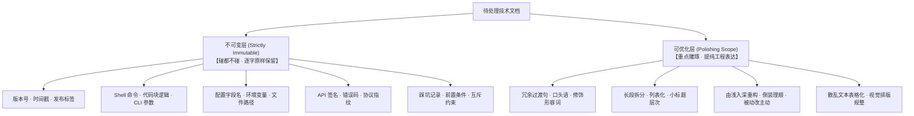
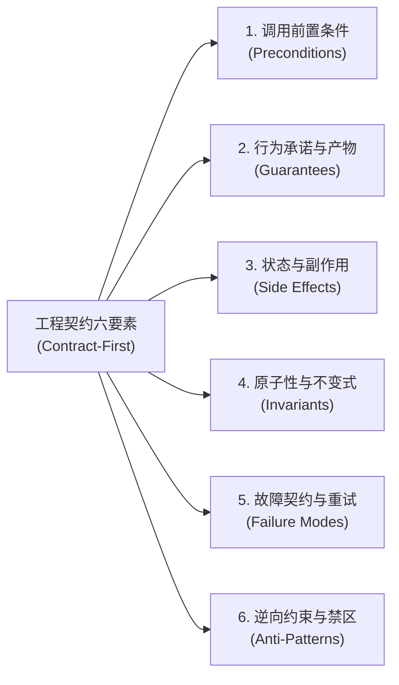
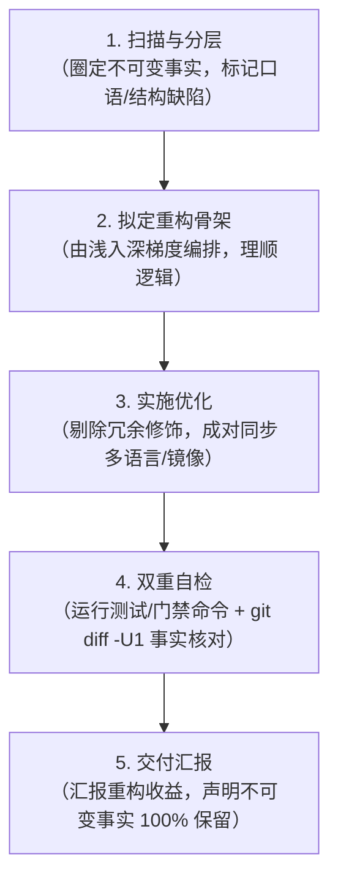

# 技术文档编写与润色规范：简洁 · 易懂 · 明了

核心宗旨：**收敛表达，绝不收缩信息——让行文利落好读，但一个事实都不能少。**

技术文档中最宝贵、不可再生的两类资产：
1. **事实性记录**：版本号、时间戳、命令、路径、配置键、API 签名、类型定义、门禁数值、状态枚举。
2. **坑位与边界记录**：为什么不能做某事、踩坑代价、前置条件、并发互斥锁、安全边界、失败示例。

常规“AI 润色”最常犯的重大事故：为了句子通顺而“概括”掉边界条件，或把看似“旧”的版本号/命令“顺手更新”，或在行文中掺杂口语、吐槽、公关腔与套路化“AI 味”。本 Skill 专为杜绝此类问题、建立工业级技术写作标准而设计。

---

## 一、 优化三原则与行文心法

| 维度 | 核心目标 | 优化手段 | 典型反例与正例对照 |
| :--- | :--- | :--- | :--- |
| **简洁**<br>*(Concise)* | 剔除冗余修饰<br>提高信息密度 | • 删空话套话（“需要注意的是”、“众所周知”、“顾名思义”）。<br>• 化繁为简（“进行...的配置” ➔ “配置...”；“通过执行...来实现...” ➔ “运行...以...”）。<br>• 消除叙事倒装与啰嗦流水账。 | ❌ 为了能够让系统成功启动，用户需要进行执行 install.ps1 脚本的操作。<br>✅ 运行 `install.ps1` 启动系统。 |
| **易懂**<br>*(Understandable)* | 结论先行<br>符合认知模型 | • 结论前置（BLUF: Bottom Line Up Front），段首第一句直给核心结论。<br>• 超过 5 行的长段落拆分；并列操作改用有序列表。<br>• 实战教程严格遵循**由浅入深（Progressive）**梯度递进编排。 | ❌ 在配置项 A 之前，如果系统没有装好 B，会导致 C 报错，因此要先装 B 再改 A。<br>✅ **先安装 B，再配置 A**（缺少 B 会触发 C 报错）。 |
| **明了**<br>*(Clear)* | 视觉清晰<br>术语严格一致 | • 全文术语前后一致，代码符号严格反引号标注。<br>• 重点加粗克制使用（每段至多 1 处，避免视觉噪音）。<br>• 多属性/多方案对照**优先采用 Markdown 表格**。 | ❌ 一会儿叫“连接器”、一会儿叫“Connector”、一会儿叫“插件”。<br>✅ 全文统一采用标准规范术语与代码符号。 |

> **读者视角检验**：第一次阅读该文档的人，能否在 10 秒内扫清“这页讲什么、我在哪、核心结论是什么、核心操作命令是什么”。

---

## 二、 核心分层：不可变层 vs 可优化层

动手修改或润色任何文档前，**必须先完成显式分层**：



### 1. 不可变层（Strictly Immutable —— 逐字保留，碰都不碰）
* **版本与历史**：语义化版本（如 `v1.2.0-beta.8`）、发布日期、变更日志具体条目。
* **执行载体**：Shell 命令、代码块实现、CLI 参数、配置字段名、环境变量、目录与文件路径。
* **契约与接口**：API 方法名、参数签名、类型定义、HTTP 路由与谓词、状态码与错误码。
* **门禁与测试**：门禁阈值、测试用例断言、数据基准数值。
* **坑位与边界**：警告（Warning/Caution）、踩坑历史、前置条件、并发锁/排他约束、失败案例。

> ⚠️ **发现事实有误怎么办？** 文档优化的职责边界是“让表述更清晰”，**更新技术事实属于另一项工作**。严禁擅自猜测或“顺手更新”。如确实过时或存在疑问，必须向用户报告确认，或以追加注记方式保留历史真实性。

### 2. 可优化层（Polishing Scope —— 重点雕琢）
* 冗余的过渡句、口头语、修饰性形容词与套话。
* 段落结构（长段拆分、列表化、提取层次小标题）。
* 叙事逻辑（由浅入深、由主到次、倒装句理顺、被动语态改为利落主动动作）。
* 排版杂乱文本的表格化与结构化规整。

---

## 三、 五条不可触碰的技术红线

1. **红线 1：不可变层逐字保留**
   * 严禁修改任何命令、版本号、路径与配置字段。
   * 严禁将具体历史事实泛化（例如：禁止将“2026-09-17 部署修复”改写为“近期修复”）。
2. **红线 2：精简表达 ≠ 删减信息点（零事实丢失）**
   * 简洁来自表达的密度与逻辑的提炼，绝不允许丢失任何一个例外条件、踩坑说明或操作步骤。
   * **机械判据**：信息项净丢失量必须为 0。单文件净删除行数大幅异常时需立即自查是否误删了有效信息。
3. **红线 3：多语言/多环境镜像绝对同构**
   * 若文档存在双语（如 `zh-CN/` 与 `en-US/`）或跨环境镜像，改动一侧必须**成对同步修改**另一侧。
   * 标题层级序列（`#`、`##`、`###`）、代码块数量及语言标识序列（`ts`, `bash` 等）、表格列数序列必须严格对齐。
4. **红线 4：严禁口语吐槽与拟人化戏谑（绝对禁区，技术严谨性底线）**
   * 官方技术文档是面向工程与生产环境的严肃资产，**必须始终保持客观、严谨、专业的技术语言**。
   * **绝对禁区形态**：
     - 情绪化吐槽与反讽（如“不再说谎”、“被网关限流在用户眼里是成功的”、“后知后觉”）。
     - 拟人化戏谑与口头禅（如“说实话”、“诚实的边界”、“偷懒”、“打架”、“瞎搞”、“耍流氓”）。
     - 主观口语评价（如“其实没必要”、“说白了就是”）。
   * **转换原则**：无条件转换为**中立客观的系统行为与因果逻辑陈述**（例如：“不再说谎” ➔ “完成 token 交换后才返回结果页面，避免异步时序误导”；“两个诚实的边界” ➔ “两项核心作用域约束”）。
5. **红线 5：锚点与门禁绝对安全**
   * 不得随意改写已有被引用锚点的标题文本，避免破坏外部链接或触发构建工具的 broken anchor 报错。
   * 项目中存在门禁校验脚本时，修改后必须全部绿标通过方可交付。

---

## 四、 彻底粉碎“AI 味”：工业级工程文档防御体系

顶级开源项目与工业级技术文档（如 Linux 内核、PostgreSQL、Stripe API、Rust RFC、Go 规范）的底色是**冷淡、客观、精确、甚至略带枯燥的克制**。必须从以下四个层面彻底根除大语言模型的套路病：

### 1. 词汇与语气层面：AI 陈词滥调与客服腔黑名单

| AI 味典型重灾区 | AI 惯用套路（必须严厉禁用） | 去 AI 味后的工程化改造 |
| :--- | :--- | :--- |
| **空洞宏大赞美** | “全方位赋能”、“优雅且强大”、“无与伦比的体验”、“一站式开箱即用解决方案” | **直接陈述机制与指标**：删掉全部形容词，只讲具体支持什么协议、特性参数或吞吐量。 |
| **客服腔与保姆腔** | “别担心，接下来让我们一步步揭开它的神秘面纱”、“亲爱的开发者，只需轻轻点击...” | **技术手册主谓宾**：“运行 `bun run dev` 启动开发服务器。” |
| **正确的废话** | “这个配置非常重要，建议开发者根据实际业务场景进行合理配置。” | **直接讲阈值与后果**：“内存预算建议配置为物理内存的 70%；超出将触发 OOM Killer 终止进程。” |
| **过度对冲与模糊词** | “通常情况下可能在某种程度上会导致一些不可预期的性能问题...” | **确定性因果契约**：“连接池耗尽时，后续请求排队超过 5000ms 将返回 `504 Gateway Timeout`。” |
| **生硬直译腔（Translationese）** | “为了利用该功能，需要对服务进行消费操作”、“作为最佳实践，请确保...” | **利落动宾短语**：“调用该接口需先完成身份认证；建议为每个客户端分配独立密钥。” |

### 2. 篇章结构层面：拆解“AI 八股文与伪结构化”

* **拒绝“总-分-总”强迫症**：
  - 严禁段首宏大叙事（“在当今快节奏的分布式系统架构中...”）；
  - 严禁小节末尾强行抒情升华（“通过上述步骤，我们不仅提升了系统稳定性，还为后续业务打下了坚实基础。”）。
  - **规则**：段首直切机制，段尾讲完立即收刀。读者查阅的是工程手册，不是抒情散文。
* **拒绝“伪列表”导致的信息稀疏**：
  - 严禁把一句话就能讲清的因果关系，强行拆成占满半屏的 `1. 2. 3. 4.` 稀疏列表。
  - **规则**：仅在存在**严格时序操作步骤**或**多维属性并行对比**时使用列表或表格；纯逻辑推导保持紧凑陈述。
* **强制结论先行（BLUF）**：
  - 杜绝思考流水账倒装（“因为 A 触发了 B，导致以前在 C 里面的 D 不能用，所以我们才做出了 E”）。
  - **规则**：改写为“现采用方案 E（彻底替代方案 D，规避由 A 引发 B 的阻塞问题）”。

### 3. 代码示例层面：拒绝“玩具代码”，立足生产真实性

AI 示例代码的通病是全篇 `const foo = "bar"`、`// 业务逻辑写在这里` 以及泛泛的 `catch (e) { console.log(e); }`。工业级文档的示例代码必须具备**生产级闭环四要素**：
1. **真实入参**：使用规范的 UUID、真实域名、完整配置结构体，杜绝 `test123` 玩具占位符。
2. **资源闭环**：有 `open/connect/spawn` 必须配对 `finally { close() }` 或生命周期回收逻辑。
3. **真实错误分支**：精准展示具体的错误类（`error instanceof AppServerError`）与错误码分流，禁止盲吞异常。
4. **明确运行上下文**：必须标明运行环境（Node.js ≥ 22 / Bun / 浏览器）、依赖包与所需前置能力位。

### 4. 认知视角层面：契约式技术文档（Contract-First Documentation）

AI 习惯于“培训讲师”视角，沉溺于描述开心路径（Happy Path）；而优秀的工程文档源于**契约式设计（Design by Contract, DbC）**。它将概率模糊的文字转换为**离散数学与状态机级别的确定性因果律**。

技术描述必须涵盖**工程契约六要素（The 6 Contract Dimensions）**：



1. **调用前置条件（Preconditions / Requires）**：调用方必须履行的义务。包含前置环境变量、宿主能力位门禁（Capability bits）、数据就绪状态、单调递增版本号或权限要求。
2. **行为承诺与产物（Guarantees / Ensures）**：调用完成后系统保证提供的确定性结果。包含返回值的强类型结构、落盘数据规格、状态机目标跃迁。
3. **状态与副作用（Side Effects & Lifecycle）**：对外部环境造成的变动。包含修改了哪些文件、占用了哪些端口、持有还是释放了长连接、广播了哪些事件、调用方的资源释放义务（如 `finally { close() }`）。
4. **原子性与不变式（Atomicity & Invariants）**：在整个操作生命周期中永不违背的真理。包含是否支持全成全败（All-or-Nothing）、快照作用域隔离规则、单目录单进程文件锁排他性。
5. **故障契约与重试语义（Failure Modes & Retryability）**：非开心路径下的确定性约定。包含精准异常类与错误码枚举、明确区分瞬时可重试错误（`retryable: true`）与业务终态拒绝（`retryable: false`）、重试所需的幂等键要求。
6. **逆向约束与禁区（What NOT to do / Anti-Patterns）**：**明确告诉读者不要做什么**。包含互斥参数组合、严禁并发调用的场景、已知性能陷阱。
   > 踩坑后的反模式警示，往往比正面教程更能体现人类工程经验的深度，是消除 AI 味的最强利器。

#### 契约式编写模版（Contract-First Template）

在编写或润色任何 API 接口、CLI 命令或系统模块时，优先套用以下标准化结构：

````markdown
### `methodName(params): Promise<ReturnType>`

- **前置条件 (Preconditions)**：调用方必须显式传递 UUID 作为 `idempotencyKey`；宿主须已启用 `skill_files` 能力位。
- **行为保证 (Guarantees)**：返回已持久化的 `Receipt` 对象；相同幂等键重复调用返回既有执行快照，不触发二次推理。
- **副作用 (Side Effects)**：在连接局部递增 `sequence` 序号，向下游广播 `message.created` 通知；若未指定 `dataDir`，将在系统临时目录写入快照。
- **原子性与不变式 (Invariants)**：`agentId` 与 `teamId` 严格互斥；会话历史快照恒为只追加（Append-Only）。
- **故障模式 (Failure Modes)**：
  - `agent_not_installed`（HTTP 404 / 业务异常）：目标专家未入库，不可重试；
  - `TransportError(phase="send")`：网络闪断，可进入指数退避重试循环。
- **禁区与反模式 (Anti-Patterns)**：严禁在未包裹 `try...finally` 的长生命周期任务中省略 `close()`；严禁对同一 `dataDir` 并发启动多个独立进程。
````

---

## 五、 四大典型文体实战专题

### 专题 1：变更日志（Changelog / Release Notes）
遵循 **“事实内核绝对冻结，叙事外壳工程化提纯”** 原则：

| 原始口语 / 槽点（绝对禁区） | 规范化转换手法 | 改造对照范式 |
| :--- | :--- | :--- |
| **情绪化吐槽 / 拟人化戏谑** | 转换为客观因果机制 | ❌ 授权回调页不再说谎：收到 code 就报成功但 token 还没换完...<br>✅ **优化 OAuth 授权回调状态反馈**：调整为完成 token 交换后再返回成功结果，避免异步时序误导。 |
| **口语流水账 / 倒装叙述** | 结论先行 + 动宾归类 | ❌ 某模块版本此前钉在 1.0.0：因为导入侧没读索引，导致...<br>✅ **修复某模块版本固化问题**：此前因导入逻辑未读取远程索引导致版本固定在占位符 1.0.0... |
| **随性拟人 / 口语化界定** | 精准提炼架构作用域 | ❌ 两个诚实的边界：资产只看顶层...<br>✅ **两项核心作用域约束**：资产具有快照作用域... |

### 专题 2：API 接口参考（API Reference & SDK）
- **类型契约显式声明**：方法签名、参数接口、返回值 Promise 必须强类型清晰完整，使用标准 TypeScript / 语言接口定义。
- **职责清晰分组**：生命周期方法、数据读写、实时事件、管理运维分类成组。
- **契约要素齐备**：前置条件、返回值保证、幂等性凭证（UUID）、乐观并发锁（CAS 版本号）、排他文件锁、权限与能力位门禁（Capability gates）必须以规范列表逐一陈述。

### 专题 3：实战与快速上手教程（Cookbook & Guides）
严格遵循**由浅入深（Progressive Disclosure）**梯次编排：
1. **入门（Quickstart）**：5～10 行代码的极简自包含范例，跑通核心闭环，强调资源优雅释放（如 `finally { close() }`）。
2. **基础（Core Concepts）**：核心数据读写、流式事件监听、参数调优。
3. **扩展（Extensibility）**：插件机制、动态能力注入、多组件协作。
4. **进阶（Advanced Workflows）**：长周期异步任务、人工审批流、资源打包与物化。
5. **生产（Architecture & Production）**：通信协议选型（WS vs HTTP）、多环境部署模式、指数退避重试（Backoff + Jitter）、生产避坑清单。

### 专题 4：系统架构与设计说明（Architecture & ADR）
- **设计权衡先行**：不仅说明“怎么做”，更要说明“为什么不采取替代方案”（Trade-offs & Constraints）。
- **结构表格化**：模块职责分工、数据流向、协议对照均以 Markdown 表格固化。
- **边界与限制显式化**：列出不支持的场景、单点瓶颈与预警机制。

---

## 六、 通用五步工作流程与自检过滤



1. **扫描与分层**：
   * 通读全文，圈定不可变事实（命令、版本、路径、字段、警告）。
   * 审查是否存在口语化吐槽、拟人戏谑或口头禅，列入重构清单。
2. **拟定重构骨架**：
   * 教程按“极简入门 $\to$ 核心交互 $\to$ 扩展编排 $\to$ 生产工程”编排。
   * 参考文档按“接口签名 $\to$ 参数契约 $\to$ 返回值 $\to$ 边界异常”编排。
3. **实施优化（成对同步）**：
   * 逐段收敛，结论前置，提炼要点。
   * 涉及双语或镜像副本时，同一批次完成两侧修改，保持结构同构。
4. **双重自检与“除味过滤器”（De-AI Filter）**：
   * **门禁自检**：运行项目自身的构建、测试或格式门禁命令。
   * **Diff 事实核验**：执行 `git diff -U1` 逐行审查，确保所有命令、参数、版本与逻辑零篡改。
   * **除味自检五问**：
     1. *废话剪枝*：删掉首段背景和末段总结，读者会丢失任何有效操作或事实吗？（若不会，立刻删）。
     2. *形容词清零*：有无出现“优雅、无缝、强大、完美、一站式”？（全部替换为具体指标或直接删除）。
     3. *客服腔清除*：有无出现“让我们、别担心、亲爱的、轻松实现”？（全部改为主谓宾动作陈述）。
     4. *信息密度*：删去 30% 铺垫字句后，技术参数、类型、命令是否 100% 毫无损失？
     5. *代码真实性*：示例代码是否存在盲吞异常、无资源释放、或玩具占位符？
5. **交付汇报**：
   * 简要说明结构与行文优化的收益。
   * 郑重声明“不可变技术事实与坑位记录 100% 完整保留”。

---

## 七、 提示词外发模板（适用于 Gemini / Claude / GPT 等）

当需要将优化任务派发给其他大模型或子 Agent 时，直接套用以下标准提示词：

````markdown
请帮我优化以下技术 Markdown 文档的行文表达与结构组织：

【文件路径/内容】：[填写待处理的文件绝对路径或粘贴正文]

【优化目标】：
1. 简洁：删除冗余修饰与废话套话（如“需要注意的是”、“众所周知”），化繁为简。
2. 易懂：结论先行，段首提炼核心要点；拆分大于 5 行的长段落；实战教程按由浅入深（快速上手 -> 核心功能 -> 进阶编排 -> 生产实践）梯次递进。
3. 明了：术语全文统一，克制使用加粗，多属性/多方案对比优先采用 Markdown 表格。
4. 契约式编写 (Contract-First)：技术描述必须明确给出前置条件 (Preconditions)、行为保证 (Guarantees)、副作用 (Side Effects)、不变式 (Invariants)、故障模式与重试语义 (Failure Modes)，以及反模式/禁区 (What NOT to do)。
5. 彻底去 AI 味：清除客服腔（“别担心”、“让我们...”）、空洞夸耀词（“优雅强大”、“全方位赋能”）与正确的废话；杜绝小节末尾强行抒情总结；示例代码严禁玩具占位符，必须包含生产级资源释放与精准异常分支。

【最高红线（必须严格遵守）】：
1. 绝对不可变层（逐字原样保留）：所有版本号、时间戳、Shell 命令、文件路径、代码块逻辑、配置键名、API 签名、错误码、警告（Warning）与踩坑记录。绝不“顺手更新”或猜测值。
2. 绝对禁区（严禁口语吐槽与拟人化戏谑）：文档必须始终是严谨、专业、客观的技术语言。严禁出现诸如“不再说谎”、“说实话”、“诚实的边界”、“瞎搞”等情绪化、拟人化或吐槽字眼，必须重构为客观的系统行为与因果逻辑陈述。
3. 零信息丢失：精简的是冗余文字，不是业务信息。严禁删减任何前置条件、例外情况、并发锁或边界逻辑。
4. 双语/镜像同构：若涉及多语言镜像，必须严格保证标题层级序列、代码块语言序列、表格列数完全一致。
````
