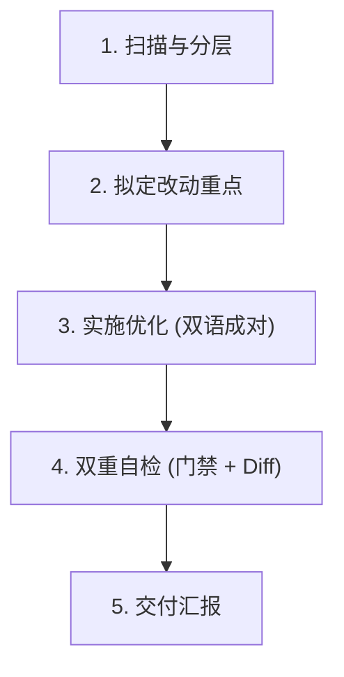

# Markdown 文档优化规范：简洁、易懂、明了

优化核心宗旨：**收敛表达，绝不收缩信息——让行文利落好读，但一个事实都不能少。**

文档中最宝贵、不可再生的是两类信息：
1. **事实性记录**：版本号、时间戳、命令、路径、配置键、API 签名、门禁数值。
2. **坑位与边界记录**：为什么不能做某事、踩坑代价、前置条件、失败示例。

常规“AI 润色”最常犯的错误，就是为了句子顺畅而“概括”掉边界条件，或把看似“旧”的版本号/命令“顺手更新”。本 Skill 专为杜绝此类事故而设计。

---

## 一、 优化三原则与对照

| 维度 | 目标 | 优化手段 | 典型反例与正例 |
| :--- | :--- | :--- | :--- |
| **简洁** | 剔除冗余修饰 | 删空话套话（“需要注意的是”、“众所周知”）；化繁为简（“进行...的配置” ➔ “配置...”）。 | ❌ 为了能够让系统成功启动，用户需要进行执行 install.ps1 脚本的操作。<br>✅ 运行 `install.ps1` 启动系统。 |
| **易懂** | 结论先行、层次分明 | 段首第一句即核心结论；超过 5 行的长段落拆分；并列操作改用有序列表。 | ❌ 在配置项 A 之前，如果系统没有装好 B，会导致 C 报错，因此要先装 B 再改 A。<br>✅ **先安装 B，再配置 A**（否则会触发 C 报错）。 |
| **明了** | 视觉清晰、术语统一 | 全局概念术语前后一致；重点加粗（每段至多 1 处，克制使用）；多属性对照优先采用 Markdown 表格。 | ❌ 一会儿叫“连接器”、一会儿叫“Connector”、一会儿叫“插件”。<br>✅ 全文统一采用标准中文名称与规范代码标识。 |

> **读者视角检验**：第一次阅读该文档的人，能否在 10 秒内扫清“这页讲什么、我在哪、核心命令是什么”。

---

## 二、 核心分层：不可变层 vs 可优化层

动手修改任何文档前，**必须先完成脑内/显式分层**：

### 1. 不可变层（Strictly Immutable）—— 逐字保留，碰都不碰
* **版本与历史**：版本号（如 `0.1.0-beta.10`）、发布日期、变更日志（Changelog）中的具体事实。
* **执行载体**：Shell 命令、代码块逻辑、CLI 参数、配置字段名、环境变量、目录与文件路径。
* **测试与门禁契约**：被脚本、门禁或断言逐字比对的字符串与结构。
* **坑位与约束**：警告（Warning/Caution）、踩坑记录、前置条件、特殊限制与例外场景。
* **合规与声明**：许可证、作者署名、第三方声明。

> ⚠️ **发现事实有误怎么办？** 文档优化的职责边界是“让表述更清晰”，**更新事实属于另一项工作**。严禁擅自猜测或“顺手更新”。如确实过时或错误，应向用户报告确认，或以追加更正注记的方式保留历史真实性。

### 2. 可优化层（Polishing Scope）—— 重点雕琢
* 冗余的过渡句、口头语、修饰性形容词与套话。
* 段落结构（长段拆分、列表化、提取小标题）。
* 句式重构（倒装句理顺、被动语态改为利落的主动动作）。
* 混乱排版的表格化与规范化。

---

## 三、 五条不可触碰的红线

1. **红线 1：不可变层逐字保留**
   * 严禁修改任何命令、版本号、路径与配置字段。
   * 严禁将具体历史事实泛化（如将“2026-09-17 部署修复”改写为“近期修复”）。
2. **红线 2：精简表达 ≠ 删减信息点**
   * 简洁来自表达的密度，绝不允许丢失任何一个例外条件、踩坑说明或操作步骤。
   * **机械判据**：信息项净丢失量必须为 0。若非结构重排（如将大段改写为表格），单文件净删除行数大幅异常时需立即自查是否误删了有效信息。
3. **红线 3：双语/多副本镜像绝对同构**
   * 若文档存在双语（如 `content/docs/zh-CN/` 与 `en-US/`）或跨文件镜像，改动一侧必须**成对同步修改**另一侧。
   * 标题层级（`#`、`##`）、代码块数量及语言标识、表格列数、段落顺序必须严格对齐。
4. **红线 4：严禁口语吐槽与拟人化戏谑（绝对禁区，技术严谨性底线）**
   * 官方技术文档是面向工程与生产环境的严肃资产，**必须始终保持客观、严谨、专业的技术语言**。
   * **绝对禁区形态**：
     - 情绪化吐槽与故事化反讽（如“连接器授权回调页不再说谎”、“被网关限流在用户眼里是成功的”、“后知后觉”）。
     - 拟人化戏谑与口头禅（如“说实话”、“诚实的边界”、“偷懒”、“打架”、“瞎搞”、“耍流氓”）。
     - 主观口语评价（如“其实没必要”、“说白了就是”）。
   * **重构原则**：遇到此类表述必须无条件转换为**中立客观的系统行为与因果逻辑陈述**（例如：“不再说谎” ➔ “完成 token 交换后才返回结果页面，避免异步时序误导”；“两个诚实的边界” ➔ “两项核心作用域约束”）。
5. **红线 5：锚点与门禁绝对安全**
   * 不得随意改写已有被引用锚点的标题文本（避免 Docusaurus 等静态站点抛出 broken anchor 或断开外部外链）。
   * 本地存在门禁命令时，优化后必须全部绿标通过方可交付。

---

## 四、 实战专题：版本变更日志（Changelog）的精炼法则

Changelog 是不可变要求最高的文档之一，但开发者的原始提交日志中往往夹杂口语、情绪化吐槽与叙事倒装。
优化 Changelog 绝非“一个字不能碰”，而是要精准实施 **“事实内核绝对冻结，叙事外壳工程化提纯”**。

### 1. 事实内核（Fact Kernel —— 100% 逐字原样保留）
* **版本与时间**：版本号（`0.1.0-beta.10`）、UTC 时间戳（`2026-10-12T07:30:00Z`）、`dist-tags`。
* **协议与数值**：指纹递增（`fp-13` $\to$ `fp-14`）、方法总数（80 $\to$ 82）、HTTP 路由数（55）。
* **接口与实体**：方法名（`import/assets`）、参数字段（`writtenAssets`）、状态枚举（`authorization_pending`）。
* **缺陷根因与边界**：网关限流（`slow_down`）、未读取市场索引导致的 `1.0.0` 冲突、token 异步交换时序等核心原因。

### 2. 叙事外壳（Narrative Shell —— 剔除口语槽点，重构为严谨工程陈述）

| 原始口语 / 槽点（绝对禁区） | 规范化转换手法 | 真实案例对照（优化前 vs 优化后） |
| :--- | :--- | :--- |
| **情绪化吐槽 / 拟人化戏谑** | 转换为客观因果机制 | ❌ 连接器授权回调页不再说谎：回调的 code 一到就回 "Authorization successful!"...<br>✅ **优化连接器 OAuth 授权回调状态反馈**：此前回调收到 code 即返回成功而 token 交换在其后执行... 现调整为完成 token 交换后才返回结果页面。 |
| **口语流水账 / 倒装** | 结论先行 + 动宾归类 | ❌ 技能与连接器条目的版本此前被钉在占位版本 1.0.0：目录侧读市场索引、导入侧不读，后果是...<br>✅ **修复技能与连接器条目版本固化问题**：此前因导入侧未读取市场索引导致版本被固定在占位符 1.0.0... |
| **随性拟人 / 口语化界定** | 精准提炼架构作用域 | ❌ 两个诚实的边界：资产是快照作用域的...<br>✅ **两项核心作用域约束**：资产具有快照作用域... |

### 3. Changelog 优化双重底线
1. **标题层级神圣不可侵犯**：`### 2.x` 版本号行、`#### 破坏性`、`#### 新增`、`#### 修复` 属于结构骨架，必须 100% 保持原有标题层级与顺序。
2. **双语对称专业化**：中文剥离口语化槽点后，英文镜像必须同步采用规范技术英文（如使用 `Connector OAuth authorization callback feedback` 而非 `page no longer lies`；使用 `Two architectural scope constraints` 而非 `Two honest boundaries`），且双语条目数量与代码标记严格一致。

---

## 五、 规范工作流程



1. **通读并分层**：
   * 识别不可变层（版本、命令、路径、警告项）。
   * 识别可优化层（冗长段落、口语化修饰、排版缺陷）。
   * 审查是否存在口语化吐槽、拟人戏谑或口头禅，列入重构清单。
   * 若改动涉及较大结构调整，先向用户简要列出分层计划再行动。
2. **动手优化**：
   * 逐段收敛，结论前置，提炼要点。
   * 彻底清除情绪化字眼，保证中立、严谨的技术文风。
   * 涉及双语或镜像副本时，同一批次完成两侧修改。
   * 代码块内的配置/代码保持原样，仅可优化说明文字或在必要时添加清晰行内注释。
3. **双重自检**：
   * **门禁自检**（根据仓库配置）：
     - 本站双语门禁：运行 `bun run check:docs-sync`，确保标题、代码块与表格完全对齐。
     - 链接/语法检查：确保无破损锚点。
   * **Diff 事实核验**：
     - 执行 `git diff -U1`，逐行核对版本号、配置名、命令参数，确保不可变内容零篡改。
4. **交付汇报**：
   * 简要说明“优化了哪些结构/表达”。
   * 声明“不可变事实与坑位记录 100% 完整保留”。
   * 如有存疑或可能已过时的业务事实，单独列出请用户定夺。

---

## 六、 生成外部 Agent（如 Gemini）提示词模板

当需要把优化任务派发给外部 Agent 或工具时，直接套用以下提示词模板：

````markdown
请帮我优化以下 Markdown 文档的行文表达：
【文件路径】：[填写待处理的文件绝对路径或相对路径]

【优化目标】：
1. 简洁：删除冗余修饰与废话套话（如“需要注意的是”），化繁为简。
2. 易懂：结论先行，段首提炼核心要点；拆分大于 5 行的长段落；操作步骤改用列表。
3. 明了：术语全文统一，克制使用加粗，并列属性优先采用表格整理。

【最高红线（必须严格遵守）】：
1. 绝对不可变层（逐字原样保留）：所有版本号、时间戳、Shell 命令、文件路径、代码块、配置键名、错误码、警告（Warning）与踩坑记录。绝不“顺手更新”或猜测值。
2. 绝对禁区（严禁口语吐槽与拟人化戏谑）：文档必须始终是严谨、专业、客观的技术语言。严禁出现诸如“不再说谎”、“说实话”、“诚实的边界”、“瞎搞”等情绪化、拟人化或吐槽字眼，必须重构为客观的系统行为与因果逻辑陈述。
3. Changelog 优化准则：若处理变更日志，严格冻结“事实内核”（版本、时间戳、接口名、指纹数值）；仅将叙事外壳重构为客观严谨的工程化陈述。
4. 零信息丢失：精简的是冗余文字，不是业务信息。严禁删减任何前置条件、例外情况或逻辑细节。
5. 镜像文档同构：若涉及中英文镜像（zh-CN / en-US），必须成对修改，且标题层级、代码块数量与表格列数必须 1:1 严格对齐。
6. 锚点安全：不得随意改动标题字面量，以免破坏现有站内链接与页面锚点。

【输出要求】：
先列出你识别出的“不可变层清单”与“优化计划概要”，经确认后再输出完整修改后的文档内容。
````

---

## 七、 常见问题自查与速查表

| 故障现象 | 常见根因 | 处置手段 |
| :--- | :--- | :--- |
| `check:docs-sync` 门禁报错 | 双语文档的标题、代码块或表格列数不对齐 | 检查 diff，比对中英两侧章节结构与代码块语言标识，保持 1:1 同构。 |
| 文档出现口语槽点或轻佻语气 | 保留了开发者原始提交中的情绪化词汇（如“不再说谎”） | 回退并重构：将拟人化槽点转换为客观系统行为说明（“完成 token 交换后才返回结果”）。 |
| 站点构建报 broken anchor | 修改了标题，导致已有的 `#xxx` 锚点链接失效 | 恢复原标题文本，或在原标题处显式保留原有锚点 ID。 |
| 版本号 / 时间戳被篡改 | 模型把历史数据当成可润色文案“优化”了 | 使用 `git checkout -- <file>` 回退该处，将该值加入不可变白名单重做。 |
| 读起来顺畅但丢失了踩坑预警 | 将长段警告合并成简短摘要时丢了细节 | 回退该段修改，将警告单独提炼为标准引用块（`> [!WARNING]`）保留全部细节。 |
| 批量改动后无法确认是否篡改了代码 | 优化过程中误触了代码块内部逻辑 | 运行 `git diff -- "*"` 仔细过滤只看代码块改动，确保代码与命令无变更。 |
